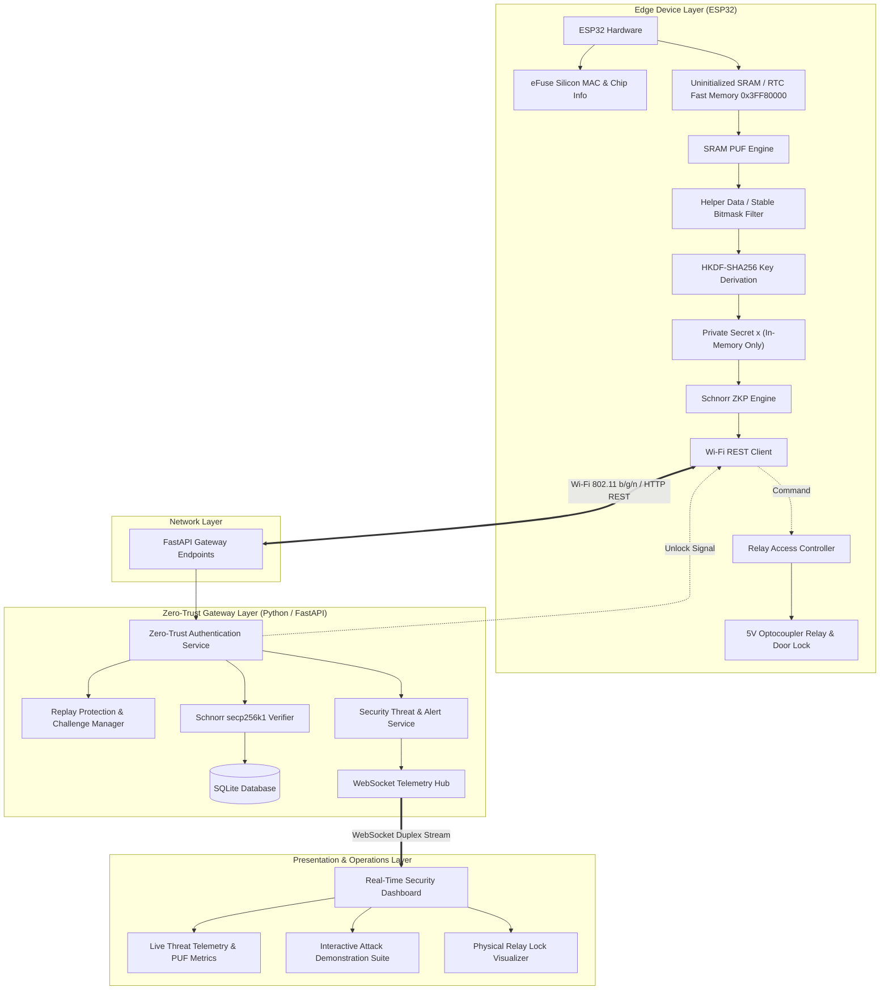
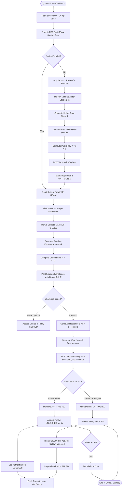
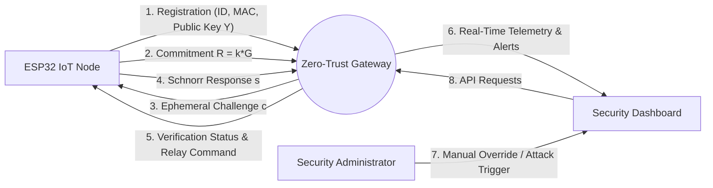
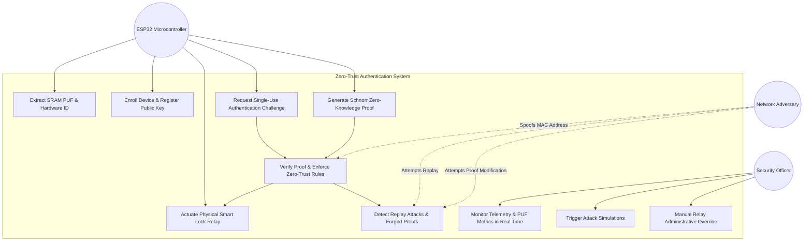
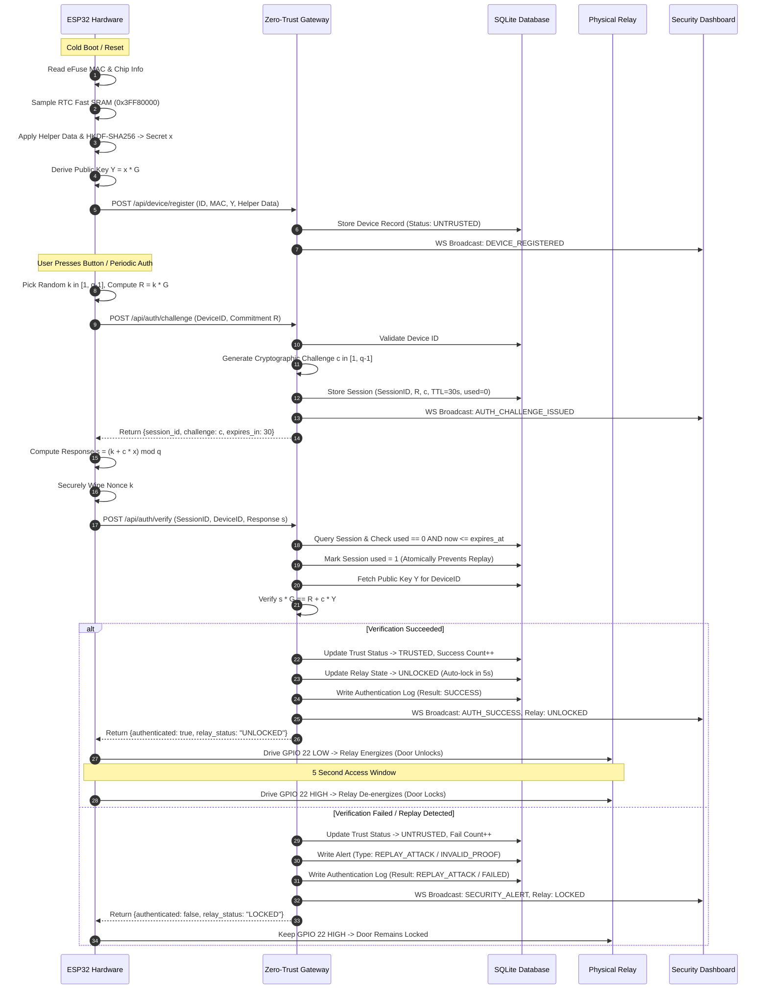
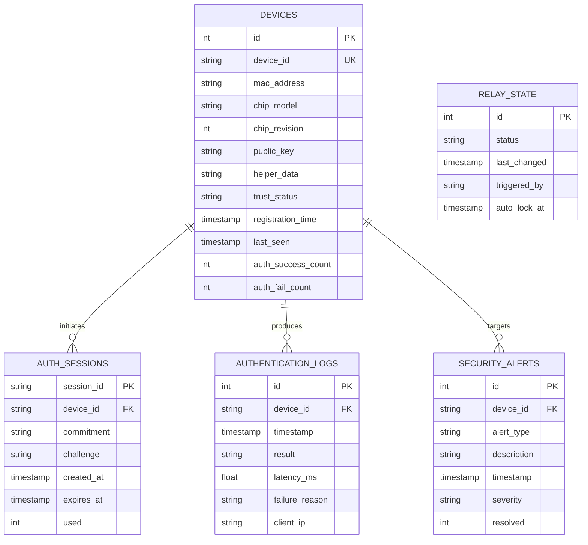
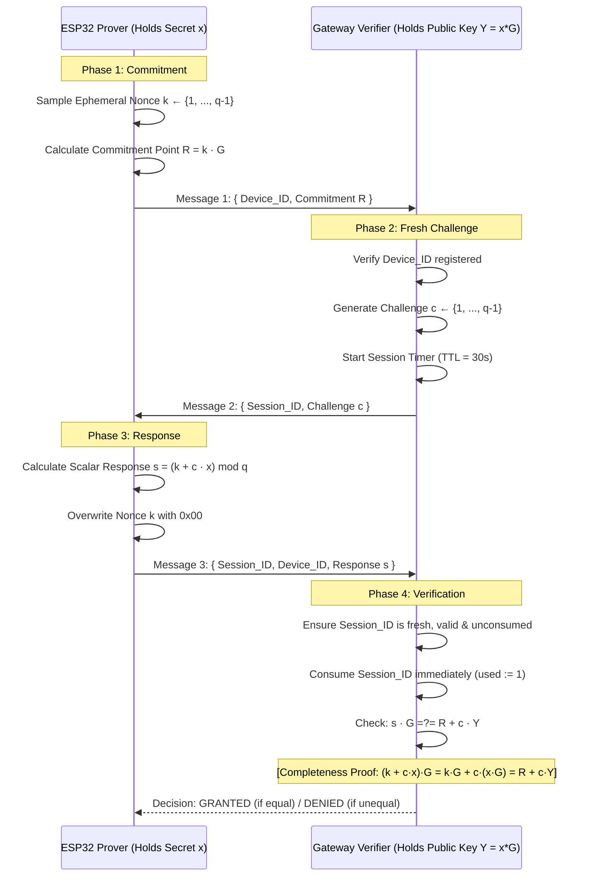
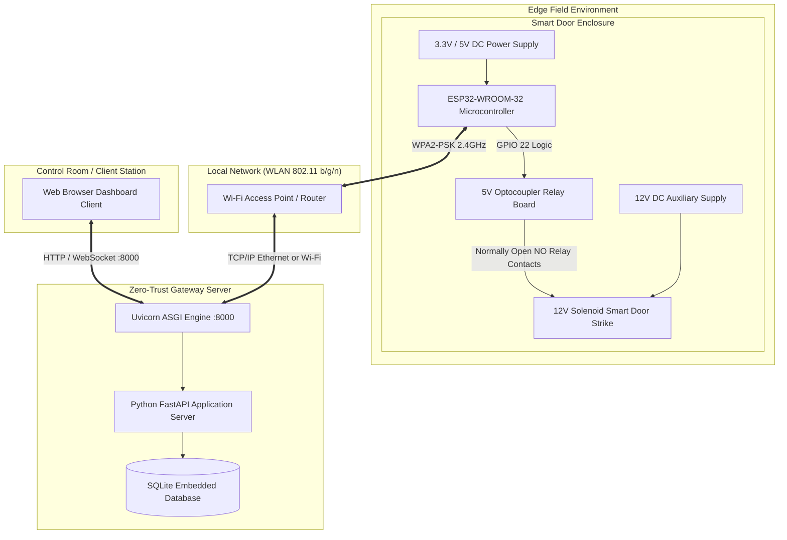

# System Architecture and Design Diagrams

This document contains the complete formal architecture diagrams for the **Hardware-Bound Zero-Trust Authentication System Using ESP32 SRAM PUF and Schnorr Zero-Knowledge Proof**.

---

## 1. System Architecture Diagram



---

## 2. System Flowchart



---

## 3. Data Flow Diagram (DFD Level 0 & Level 1)

### Level 0 Context Diagram


### Level 1 DFD

```mermaid
graph TB
    subgraph ESP32 Boundary
        D1[Silicon SRAM & eFuse] --> P1[PUF Extraction & KDF]
        P1 -->|Private Secret x| P2[Schnorr Prover]
        P2 -->|Commitment R| P3[Network Interface]
        P3 -->|Response s| P2
    end

    subgraph Gateway Boundary
        P3 ==>|HTTP POST| P4[Authentication Controller]
        P4 -->|Store Session| D2[(Session Store)]
        P4 -->|Fetch Key Y| D3[(Device Registry)]
        P4 --> P5[secp256k1 Verifier]
        D2 --> P5
        D3 --> P5
        P5 -->|Log Result| D4[(Audit Logs)]
        P5 -->|Raise Event| P6[Alert & Threat Engine]
        P6 -->|Write Alert| D5[(Security Alerts)]
        P5 -->|State Change| P7[Relay State Manager]
        P7 --> D6[(Relay State)]
        P6 --> P8[WebSocket Broadcaster]
        P7 --> P8
    end

    P8 ==>|WS JSON Stream| UI[Dashboard UI]
```


---

## 4. Use Case Diagram



---

## 5. Sequence Diagram: Complete System Interaction



---

## 6. Entity Relationship (ER) Diagram



---

## 7. Interactive 3-Pass Schnorr Authentication Sequence



---

## 8. Deployment Diagram



---

## 9. Hardware Connection Diagram

```mermaid
graph LR
    subgraph "ESP32 DevKit V1"
        ESP_3V3[3V3]
        ESP_GND[GND]
        ESP_GPIO22[GPIO 22]
        ESP_GPIO0[GPIO 0 - BOOT]
        ESP_VIN[VIN / 5V]
    end

    subgraph "5V Relay Module (Optocoupler Isolated)"
        R_VCC[VCC (+5V)]
        R_GND[GND]
        R_IN[IN (Active LOW)]
        R_JD_VCC[JD-VCC (Relay Coil 5V)]
        R_COM[COM (Common Contact)]
        R_NO[NO (Normally Open Contact)]
        R_NC[NC (Normally Closed Contact)]
    end

    subgraph "Power Supply & Lock"
        DC5V_POS[+5V DC Rail]
        DC_GND[Common GND Rail]
        DC12V_POS[+12V DC Power]
        SOLENOID[12V Solenoid Door Strike]
        FLYBACK[1N4007 Flyback Diode]
    end

    DC5V_POS --> ESP_VIN
    DC5V_POS --> R_VCC
    DC5V_POS --> R_JD_VCC
    DC_GND --> ESP_GND
    DC_GND --> R_GND

    ESP_GPIO22 -->|Logic Signal| R_IN

    DC12V_POS --> R_COM
    R_NO --> SOLENOID
    SOLENOID --> DC_GND
    FLYBACK -.->|Reverse Biased across Coil| SOLENOID
```
